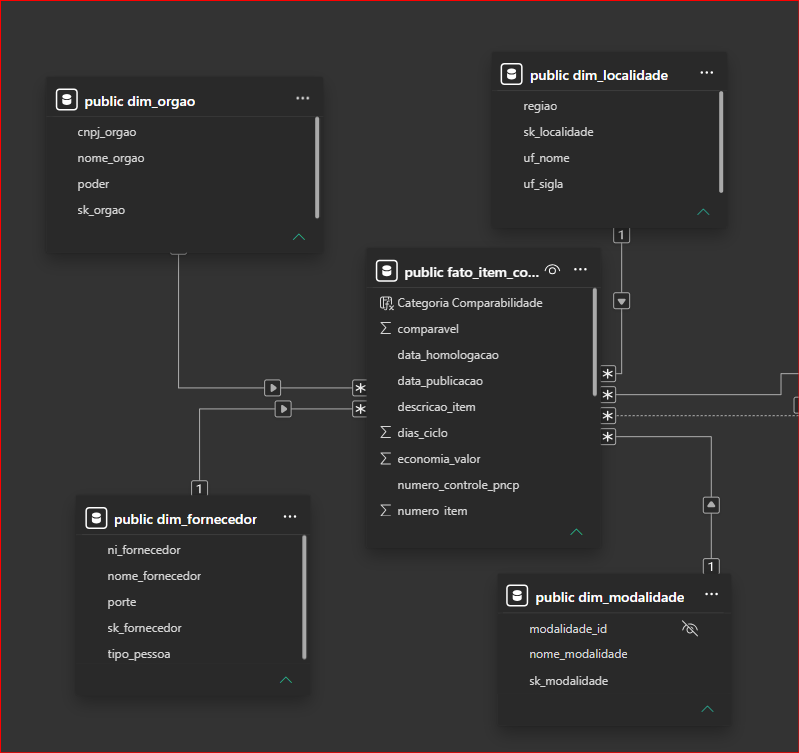
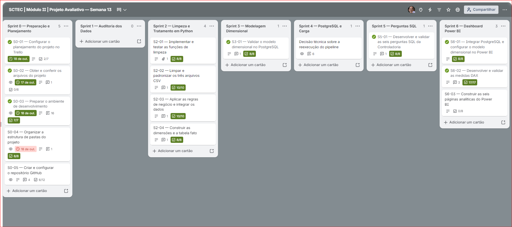
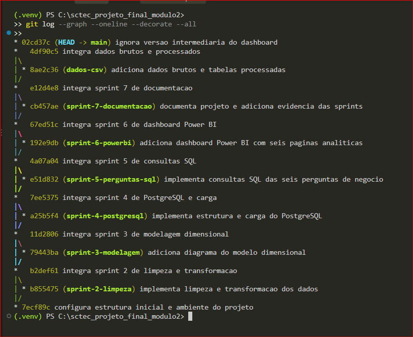

# Projeto Avaliativo SCTEC — Módulo II | Semana 13

## 1. Apresentação e problema de negócio
Este projeto desenvolve uma esteira de Engenharia e Análise de Dados sobre contratações públicas, com o objetivo de apoiar a leitura de indicadores por uma **Controladoria**. A solução trata arquivos CSV, aplica regras de negócio, organiza os resultados em um modelo dimensional no PostgreSQL e apresenta seis perspectivas analíticas no Power BI.

**Perguntas de negócio:**

1. **P1 — Economia:** qual foi a economia estimada nas contratações comparáveis?
2. **P2 — Fornecedores:** em que medida os recursos se concentram nos maiores fornecedores?
3. **P3 — Modalidades:** como se distribuem os valores e o deságio entre modalidades de contratação?
4. **P4 — Ciclo:** quanto tempo decorre entre publicação e homologação?
5. **P5 — Regional:** como os valores homologados estão distribuídos por região?
6. **P6 — Perfil do gasto:** qual a participação de Bens, Serviços e Obras e engenharia?

> **Alcance:** os valores são **homologados**, não necessariamente pagamentos realizados. Os resultados são análises da base disponibilizada, não conclusões de auditoria sobre regularidade de contratações.

## 2. Arquitetura da solução e decisões técnicas

```text
compras.csv + itens.csv + resultados.csv
                  |
                  v
     Python + pandas (limpeza e regras)
                  |
                  v
         data/processed/*.csv
                  |
                  v
 PostgreSQL — esquema public (modelo estrela)
                  |
                  +--> SQL: seis perguntas de negócio
                  |
                  v
          Power BI — painéis P1 a P6
```

**Decisões adotadas:**

- **CSV bruto preservado:** as transformações são feitas por scripts, sem reescrever os dados de origem.
- **Identificadores tratados como texto:** preserva zeros à esquerda de CNPJ/CPF e identificadores não convencionais.
- **Separação de responsabilidades:** `limpeza.py` padroniza valores; `montar_tabelas.py` aplica as regras e gera o modelo; `carregar.py` realiza a carga no banco.
- **Modelo estrela:** uma tabela fato no grão **um item contratado com resultado selecionado por contratação** e quatro dimensões com chaves substitutas (`sk_`).
- **Integridade relacional:** chaves primárias nas dimensões e estrangeiras na fato, verificadas no PostgreSQL.
- **Carga completa (`full load`):** `src/carregar.py` recria o banco antes de carregar os dados. **Essa operação é destrutiva** e requer confirmação prévia do destino e proteção da base existente.
- **Reprodutibilidade:** consultas SQL, código Python, registros de validação e documentação do planejamento compõem as evidências.

## 3. Tecnologias e ambiente

- Python 3.12.0 e pandas (conforme ambiente registrado no projeto)
- PostgreSQL 18.4 e pgAdmin 4 9.6
- Power BI Desktop 2.159.883.0
- Visual Studio Code 1.141.2
- Git 2.54.0.windows.1 e GitHub
- Trello para organização das Sprints

> As versões são as registradas durante o desenvolvimento; outros ambientes podem exigir pequenas adaptações.

## 4. Organização dos arquivos

```text
sctec_projeto_final_modulo2/
├── data/
│   ├── raw/                 # compras.csv, itens.csv, resultados.csv
│   └── processed/           # CSVs das quatro dimensões e da tabela fato
├── docs/
│   └── img/
│       ├── sprints.png             # PENDENTE: imagem do quadro Trello
│       └── modelo_dimensional.png  # PENDENTE: imagem do modelo estrela
├── powerbi/
│   └── PNCP_Controladoria.pbix
├── reports/                 # evidências e relatórios complementares
├── sql/
│   ├── 01_criar_banco.sql
│   └── 02_perguntas.sql
├── src/
│   ├── __init__.py
│   ├── config.py
│   ├── banco.py
│   ├── limpeza.py
│   ├── montar_tabelas.py
│   └── carregar.py
├── .env.example
├── .gitignore
├── requirements.txt
└── README.md
```

Os caminhos acima representam a estrutura de referência da versão desenvolvida. **A pasta `.venv/`, o arquivo `.env` real e credenciais não devem ser publicados no repositório.** Os arquivos brutos devem ser publicados apenas se o kit e suas condições de uso autorizarem.

## 5. Diagnóstico inicial e qualidade dos dados

### 5.1 Arquivos de origem

| Arquivo | Registros lidos |
|---|---:|
| `compras.csv` | 2.042 |
| `itens.csv` | 7.077 |
| `resultados.csv` | 15.896 |

A consolidação selecionou **6.225 itens com resultado antes da rejeição**, excluiu **99 itens** pelas regras de validação e produziu uma tabela fato com **6.126 itens**.

### 5.2 Dicionário das inconsistências e tratamento

| Tema | Risco identificado ou previsto no tratamento | Regra aplicada |
|---|---|---|
| CNPJ/CPF e documentos | Máscaras, zeros à esquerda e variações de formato | Leitura inicial como texto e `limpar_documento`, respeitando o tipo da pessoa |
| Nomes, siglas e descrições | Diferenças de grafia e capitalização | Padronização textual em `src/limpeza.py` |
| Campos vazios e nulos disfarçados | Ausência de informação ser confundida com zero | Conversão apropriada e preservação de `NULL` quando aplicável |
| Valores monetários e quantidades | Separadores e formatos inconsistentes | Conversão numérica e cálculo dos totais por quantidade selecionada |
| Datas de publicação e resultado | Datas inválidas ou homologação anterior à publicação | Conversão temporal; homologação cronologicamente inválida transformada em `NULL` |
| Resultados cancelados ou duplicados | Mais de um resultado associado ao mesmo item | Exclusão dos cancelados, ordenação por classificação e sequencial, seleção de um resultado por item |
| Itens sigilosos ou com valores inválidos | Quantidades/preços não positivos, estimativa muito pequena, valores extremos | Rejeição conforme Regra 4 |
| Texto com acentuação/codificação | Potencial corrupção de caracteres (`Ã`, `Â`) | Conferência necessária na auditoria dos arquivos brutos; não afirmar quantidade sem evidência |
| Documentos não convencionais | Identificadores distintos de CPF/CNPJ convencionais | Preservação integral em `VARCHAR(30)`; natureza e validade ainda pendentes de confirmação |

**Identificadores não convencionais preservados:** `ES.TRA.NG0/0024-21` e `DUNS-97092690581`. A estrutura comporta esses textos sem truncamento. A preservação não valida sua autenticidade.

### Auditoria de identificadores — compras.csv

Em 26/10/2026, foi realizada uma verificação exploratória do campo `numero_controle_pncp`, utilizando Python e Pandas.

| Indicador | Resultado |
|---|---:|
| Registros analisados | 2.042 |
| Identificadores ausentes | 0 |
| Identificadores distintos | 2.042 |
| Registros duplicados | 0 |
| Identificadores com repetição | 0 |

**Conclusão:** não foram identificadas duplicidades nem valores nulos no campo `numero_controle_pncp` do arquivo `compras.csv`. Todos os 2.042 registros possuem identificadores distintos.

**Auditorias ainda pendentes:** verificar nulos disfarçados, problemas de codificação de caracteres e datas cronologicamente inconsistentes nos arquivos de origem.
### Auditoria de valores ausentes e nulos disfarçados

Em 26/10/2026, foi realizada uma auditoria exploratória dos três arquivos CSV originais, utilizando Python e Pandas.

Foram identificadas as seguintes ocorrências de campos vazios ou marcadores de ausência (`-`, `N/A`, `NA`, `NULL`, `NONE` e `NAN`):

| Arquivo | Coluna | Ocorrências |
|---|---|---:|
| `compras.csv` | `processo` | 50 |
| `compras.csv` | `modo_disputa` | 41 |
| `compras.csv` | `data_abertura_proposta` | 617 |
| `compras.csv` | `data_encerramento_proposta` | 617 |
| `itens.csv` | `unidade_medida` | 9 |
| `itens.csv` | `situacao_item` | 140 |
| `itens.csv` | `catalogo_codigo_item` | 7.068 |
| `resultados.csv` | `ordem_classificacao_srp` | 11.976 |
| `resultados.csv` | `porte` | 299 |
| `resultados.csv` | `data_cancelamento` | 15.834 |

**Totais de ocorrências por arquivo:**

- `compras.csv`: 1.325 células.
- `itens.csv`: 7.217 células.
- `resultados.csv`: 28.109 células.
- **Total geral: 36.651 células com marcadores de ausência.**

As contagens representam ocorrências em células, não quantidades de registros distintos.

**Interpretação:** nem toda ausência representa uma inconsistência. Por exemplo, uma data de cancelamento não preenchida pode ser compatível com um resultado não cancelado. A ausência de determinados campos também pode estar relacionada às características da contratação.

Por esse motivo, os dados ausentes devem ser avaliados conforme a finalidade de cada coluna e as regras de negócio aplicáveis, evitando substituir indiscriminadamente valores desconhecidos por zero.

**Auditoria ainda pendente:** investigar datas de homologação ausentes ou anteriores à data de publicação, distinguindo os motivos que impedem o cálculo do ciclo.

### Auditoria de codificação de caracteres

Em 26/10/2026, foi realizada uma análise exploratória de possíveis problemas de codificação nos três arquivos CSV originais e nos arquivos processados pelo pipeline Python.

**Dados originais:** foram encontrados exemplos de textos com caracteres corrompidos, como `Contratação`, `São Carlos` e `Três Lagoas`, indicando possíveis problemas de interpretação da codificação de caracteres.

A primeira pesquisa identificou 806 ocorrências suspeitas distribuídas pelos três arquivos originais. Entretanto, essa contagem inclui falsos positivos, pois letras como `Ã` e `Â` também aparecem legitimamente em português.

**Dados processados:** as quatro tabelas dimensionais não apresentaram ocorrências no padrão inicial pesquisado. A tabela `fato_item_contratado.csv`, com 6.126 registros, apresentou 247 ocorrências suspeitas nesse teste inicial.

Foi realizada uma segunda verificação, utilizando sequências mais específicas de codificação incorreta. Nessa análise, foram encontradas **zero descrições correspondentes às sequências pesquisadas**.

**Conclusão:** a verificação específica não encontrou ocorrências dos padrões pesquisados na coluna `descricao_item` da tabela fato processada. Isso não comprova a ausência de todos os tipos de corrupção de caracteres nem que todos os problemas encontrados na origem tenham sido corrigidos. Os arquivos originais foram preservados, evitando alterações indiscriminadas em textos legítimos.

### 5.3 Itens rejeitados — Regra 4

Dos 6.225 itens com resultado, **99 foram rejeitados**, restando 6.126 na fato. Entre os motivos previstos na implementação estão: quantidade ou preços não positivos, item sigiloso, valor estimado abaixo do mínimo estabelecido, homologação superior a mil vezes o estimado e totais superiores a R$ 1 trilhão.

### Auditoria quantitativa dos motivos de rejeição

A execução do script `src/montar_tabelas.py`, em 26/10/2026, identificou **99 itens distintos rejeitados**, entre os 6.225 itens selecionados antes da aplicação da Regra 4.

| Motivo da rejeição | Quantidade |
|---|---:|
| Quantidade menor ou igual a zero | 1 |
| Valor unitário estimado inválido | 23 |
| Valor unitário homologado inválido | 6 |
| Item sigiloso | 0 |
| Valor total estimado inferior a R$ 1 | 85 |
| Valor homologado superior a 1.000 vezes o estimado | 60 |
| Valor total estimado superior a R$ 1 trilhão | 3 |
| Valor total homologado superior a R$ 1 trilhão | 0 |

**Observação:** os motivos não são mutuamente exclusivos. Um mesmo item pode atender a mais de uma condição de rejeição. Por isso, a soma das ocorrências por motivo é superior ao total de 99 itens distintos excluídos.

Após a aplicação da regra, permaneceram **6.126 itens válidos**, utilizados na construção da tabela `fato_item_contratado`.

A conferência após a execução confirmou os principais indicadores de referência, incluindo R$ 8.044.498.805,74 de volume homologado, 5.457 itens comparáveis e economia percentual de 14,46%.

### 5.4 Cronologia — Regra 7

A Regra 7 verifica a coerência cronológica entre as datas de publicação e homologação das contratações.

Em 26/10/2026, foi executada uma auditoria específica no arquivo `src/montar_tabelas.py`, antes da anulação das datas inconsistentes.

### Resultado da auditoria cronológica

| Indicador | Quantidade |
|---|---:|
| Itens válidos na tabela fato | 6.126 |
| Datas de resultado ausentes após o tratamento inicial | 0 |
| Datas de homologação anteriores à publicação | 230 |
| Itens sem ciclo calculável após o tratamento | 230 |
| Itens com ciclo calculável | 5.896 |

**Tratamento aplicado:** quando a data de homologação é anterior à data de publicação, o programa substitui a homologação por `None`, preservando o item contratado na tabela fato.

Consequentemente, o campo `dias_ciclo` permanece sem valor nesses registros.

Os **230 itens afetados representam 3,75% da base** e não participam dos cálculos de duração média ou máxima do ciclo.

**Justificativa técnica:** atribuir uma duração negativa ou substituir datas inválidas por valores artificiais produziria indicadores temporais incorretos.

**Limitação:** a auditoria identificou inconsistências cronológicas nos dados utilizados pelo pipeline. Não é possível determinar, apenas com essas informações, qual das datas originais estava incorreta ou qual seria a data verdadeira de homologação.

A decisão adotada foi preservar os itens para as demais análises e restringir os indicadores temporais aos **5.896 itens com ciclo calculável**.

### 5.5 Perfil do gasto — Regra 8

A classificação usa a combinação de **`descricao_item` + `objeto_compra`**, em letras maiúsculas, com busca por palavras inteiras. A expressão implementada é:

```python
r"\b(?:OBRA|OBRAS|CONSTRUÇÃO|CONSTRUCAO|REFORMA|ENGENHARIA)\b"
```

A prioridade é **Obras e engenharia > Serviços > Bens**. O termo `OBRA` no singular foi incluído durante a revisão. A classificação atual foi reconciliada entre CSV processado, PostgreSQL e Power BI: **967 itens** em Obras e engenharia, representando **60,8163%** do volume (60,8% com uma casa decimal).

**Limitação:** a expressão pesquisa os termos especificados e não equivale a um classificador semântico completo de todas as formas e flexões da língua portuguesa.

## 6. Diagrama da modelagem dimensional

O projeto utiliza a **modelagem dimensional em esquema estrela (*Star Schema*)**, composta por uma tabela fato central (`fato_item_contratado`) e quatro dimensões: `dim_orgao`, `dim_fornecedor`, `dim_modalidade` e `dim_localidade`.

Essa arquitetura foi adotada para organizar os dados das contratações públicas, facilitar as consultas analíticas no PostgreSQL e permitir a construção dos indicadores da Controladoria no Power BI.

### 6.1 Estrutura e granularidade do modelo

A tabela fato possui a seguinte granularidade:

**Uma linha representa um item contratado com resultado selecionado, após a aplicação das regras de tratamento e exclusão.**

O modelo dimensional contém as seguintes tabelas:

| Tabela | Chave | Registros validados | Finalidade |
|---|---|---:|---|
| `fato_item_contratado` | `sk_fato` | 6.126 | Registra itens, valores estimados e homologados, economia, comparabilidade, datas e ciclo |
| `dim_orgao` | `sk_orgao` | 363 | Identifica os órgãos compradores e seus respectivos poderes |
| `dim_fornecedor` | `sk_fornecedor` | 2.652 | Identifica os fornecedores e suas características |
| `dim_modalidade` | `sk_modalidade` | 7 | Classifica as modalidades das contratações |
| `dim_localidade` | `sk_localidade` | 27 | Identifica as unidades federativas e regiões brasileiras |

### 6.2 Diagrama do modelo dimensional

A figura apresenta a tabela fato central e seus relacionamentos com as quatro dimensões do esquema estrela.



*Fonte: captura da Exibição de Modelo do Power BI Desktop, destacando a estrutura dimensional principal utilizada no projeto.*

### 6.3 Relacionamentos e integridade referencial

As tabelas dimensionais possuem **chaves substitutas (*surrogate keys*)**, identificadas pelo prefixo `sk_`.

Os relacionamentos com a tabela fato são do tipo **um para muitos (1:N)**:

| Dimensão — lado 1 | Tabela fato — lado N |
|---|---|
| `dim_orgao.sk_orgao` | `fato_item_contratado.sk_orgao` |
| `dim_fornecedor.sk_fornecedor` | `fato_item_contratado.sk_fornecedor` |
| `dim_modalidade.sk_modalidade` | `fato_item_contratado.sk_modalidade` |
| `dim_localidade.sk_localidade` | `fato_item_contratado.sk_localidade` |

Essa estrutura permite analisar os indicadores por órgão, fornecedor, modalidade e localização, mantendo os dados descritivos organizados nas dimensões.

A integridade referencial foi conferida no PostgreSQL. As consultas de validação **não identificaram chaves estrangeiras órfãs** nos quatro relacionamentos.

### 6.4 Estruturas auxiliares do Power BI

Além das cinco tabelas do modelo dimensional principal, o Power BI utiliza três estruturas auxiliares:

- **`Calendario`:** permite análises temporais utilizando as datas de publicação e homologação. O modelo possui relacionamentos temporais ativo e inativo, utilizados conforme a medida DAX.
- **`_Medidas`:** organiza as medidas DAX utilizadas nos indicadores e gráficos das seis perguntas de negócio.
- **`Grupos de Fornecedores`:** auxilia nas análises de concentração financeira dos maiores fornecedores em comparação com os demais.

Essas estruturas complementam as análises realizadas no Power BI, mas não integram as quatro dimensões principais armazenadas no PostgreSQL.

### 6.5 Justificativa da arquitetura

A adoção do esquema estrela oferece benefícios para o projeto:

- Facilita a organização dos dados e a interpretação das relações entre tabelas.
- Simplifica as consultas SQL e a elaboração dos dashboards.
- Permite analisar os indicadores sob diferentes perspectivas.
- Reduz a repetição de informações descritivas na tabela fato.
- Favorece a manutenção, a validação e a evolução da solução.

A modelagem foi validada com **6.126 itens contratados**, quatro dimensões e integridade referencial preservada.

## 7. Planejamento e evolução das Sprints

As atividades, decisões, impedimentos e evidências são registrados no quadro Trello **SCTEC | Módulo II | Projeto Avaliativo — Semana 13**. A documentação inclui etapas de preparação, auditoria, tratamento em Python, modelagem, PostgreSQL/carga, consultas, Power BI e entrega.



**Acompanhamento do projeto no Trello**

O planejamento, a evolução das atividades, os checklists, os impedimentos e as decisões técnicas podem ser consultados no quadro público do projeto:

[Consultar o quadro do Projeto Avaliativo SCTEC no Trello](https://trello.com/b/8pQw4NST/sctec-modulo-ii-projeto-avaliativo-semana-13)


### Histórico de versionamento e integração das Sprints

O versionamento do Projeto Avaliativo SCTEC foi realizado com Git, utilizando a branch `main` para consolidar as entregas e branches específicas para organizar os arquivos das etapas técnicas.

Foram registrados commits descritivos, com mensagens no modo imperativo. A integração das branches foi realizada com `git merge --no-ff`, preservando a identificação das Sprints no histórico.

A figura apresenta a árvore de commits desde a configuração inicial até o commit `02cd37c`, incluindo as Sprints 2 a 7 e a incorporação dos arquivos CSV.



**Observação:** o histórico representa a consolidação do projeto no Git. As branches foram organizadas durante essa consolidação e não representam, necessariamente, as datas originais de desenvolvimento de cada Sprint. Os commits posteriores à captura poderão ser consultados diretamente no repositório GitHub.

## 8. Guia de reprodução


### 8.1 Pré-requisitos

Instale Python, PostgreSQL e Power BI Desktop. Configure o usuário e o acesso ao PostgreSQL conforme `src/config.py` e as variáveis previstas no `.env.example`. **Não coloque senhas reais no README, no Git ou nos arquivos de exemplo.**

No PowerShell, a partir da pasta do projeto:

```powershell
python -m venv .venv
.\.venv\Scripts\Activate.ps1
python -m pip install -r requirements.txt
```

Disponibilize os arquivos `compras.csv`, `itens.csv` e `resultados.csv` em `data/raw/`, respeitando as permissões do kit.

### 8.2 Construir os CSVs tratados

```powershell
python -m src.montar_tabelas
```

Os arquivos gerados em `data/processed/` são: `dim_orgao.csv`, `dim_fornecedor.csv`, `dim_modalidade.csv`, `dim_localidade.csv` e `fato_item_contratado.csv`.

### 8.3 Criar e carregar o PostgreSQL — atenção

O comando abaixo executa uma **carga completa com recriação do banco de destino**:

```powershell
python -m src.carregar
```

**Não execute esse comando contra um banco com dados que precise preservar.** Antes, revise `src/config.py`, confirme o banco de destino, providencie uma cópia de segurança e teste em ambiente isolado. O script utiliza `sql/01_criar_banco.sql`, carrega primeiro as dimensões e depois a fato.

**Estado de validação:** a linha de contagem `SELECT COUNT(*) FROM {tabela}` foi corrigida, passou em `py_compile` e foi testada em consultas isoladas. **A reconstrução integrada do banco ainda não foi testada depois da correção**; não é correto apresentá-la como reprodução integral já comprovada.

### 8.4 Executar consultas de negócio

O arquivo `sql/02_perguntas.sql` reúne as consultas para as seis perguntas. Execute-o no cliente SQL conectado ao banco de destino (por exemplo, pgAdmin), ou utilize as rotinas de consulta do projeto.

As seis consultas foram exercitadas em modo de leitura, e seus principais resultados estão resumidos na seção seguinte.

### 8.5 Abrir o Power BI

Abra `powerbi/PNCP_Controladoria.pbix`. Confira as configurações da fonte PostgreSQL e as credenciais **no próprio Power BI**; atualize a conexão se necessário. O relatório contém as páginas P1 a P6.

## 9. Respostas às seis perguntas da Controladoria

### P1 — Economia global

- **5.457 itens comparáveis**.
- Valor estimado comparável: **R$ 6.867.663.469,91**.
- Economia calculada: **R$ 992.861.686,95**, ou **14,46%** do valor estimado comparável.

A economia é calculada a partir da diferença entre estimado e homologado nos itens classificados como comparáveis. **Não equivale automaticamente a economia orçamentária efetivamente realizada.** Credenciamento não é comparável pela Regra 6.

### P2 — Concentração de fornecedores

- Fornecedores distintos: **2.652**.
- Dez maiores fornecedores: **R$ 3.332.484.029,86**, equivalentes a **41,43%** do volume homologado.
- Demais fornecedores: **58,57%**.

Essa concentração sinaliza um tema de acompanhamento, mas não caracteriza isoladamente irregularidade.

### P3 — Modalidades

- **7 modalidades**.
- **Concorrência — Eletrônica** lidera em volume: **R$ 4.700.493.122,98**, aproximadamente **58,43%** do total.
- **Pregão — Eletrônico** apresenta economia percentual de **24,02%** entre seus itens comparáveis.
- **Credenciamento** registra **R$ 2.141.301.557,16** homologados, com **zero itens comparáveis**; logo, a economia percentual é **não calculável**, e não 0%.

Os percentuais de economia variam por modalidade e dependem do conjunto de itens comparáveis de cada uma.

### P4 — Ciclo entre publicação e homologação

- Média global: **48,09 dias**, somente entre itens com ciclo calculável.
- Ciclo máximo individual: **611 dias**.
- Itens sem ciclo: **230**.
- A consulta SQL por órgão, exigindo pelo menos cinco itens com ciclo, retornou **142 órgãos**; a maior média entre os selecionados foi **266,3 dias**, na Universidade Federal de Campina Grande (16 itens com ciclo).

**Diferença de apresentação:** a consulta SQL de P4 agrupa por órgão; a página P4 do Power BI apresenta sobretudo a evolução mensal por data de publicação. São recortes complementares, cuja correspondência com a pergunta oficial deve ser revisada antes da entrega.

Um ciclo longo não significa necessariamente irregularidade.

### P5 — Distribuição regional

| Região | Itens | Participação no homologado |
|---|---:|---:|
| Centro-Oeste | 940 | 44,25% |
| Nordeste | 1.155 | 23,00% |
| Sudeste | 2.072 | 13,47% |
| Sul | 1.325 | 12,70% |
| Norte | 634 | 6,58% |

O **Centro-Oeste** lidera em recursos, mas o **Sudeste** apresenta mais itens. Na análise de contratações distintas por região no Power BI, o Sudeste também lidera, com **613 contratações**, enquanto o Centro-Oeste possui **381**.

A localização da contratação não comprova o local de execução do objeto.

### P6 — Perfil do gasto

| Perfil | Itens | Volume homologado | Participação |
|---|---:|---:|---:|
| Obras e engenharia | 967 | R$ 4.892.362.732,70 | 60,82% |
| Serviços | 1.849 | R$ 2.940.950.885,18 | 36,56% |
| Bens | 3.310 | R$ 211.185.187,86 | 2,63% |

A soma dos percentuais exibidos é **100,01% por arredondamento**. Obras e engenharia concentra a maior parcela financeira, embora Bens tenha a maior quantidade de itens.

O ticket médio global é **R$ 1.313.173,16 por item**, calculado dividindo-se o volume homologado pelos 6.126 itens.

## 10. Conferências e reconciliação

| Indicador | Resultado validado |
|---|---:|
| Arquivo `compras.csv` | 2.042 registros |
| Arquivo `itens.csv` | 7.077 registros |
| Arquivo `resultados.csv` | 15.896 registros |
| Itens antes da rejeição | 6.225 |
| Itens rejeitados | 99 |
| Itens na fato | 6.126 |
| Contratações distintas | 1.962 |
| Fornecedores | 2.652 |
| Órgãos | 363 |
| Modalidades | 7 |
| Localidades (UFs) | 27 |
| Itens comparáveis | 5.457 |
| Valor total homologado | R$ 8.044.498.805,74 |
| Economia calculada | R$ 992.861.686,95 (14,46%) |
| Ciclo médio / máximo | 48,09 / 611 dias |
| Itens sem ciclo | 230 |
| Problemas de integridade referencial nas quatro dimensões | 0 |

Esses valores foram conferidos por consultas de leitura no PostgreSQL; a classificação P6 também foi reconciliada com o CSV processado e com o dashboard.

## 11. Decisões, limitações e pendências

- **Reconstrução do banco:** a estratégia de `full load` foi documentada, mas falta teste integrado controlado após a correção da consulta de contagem no `carregar.py`.
- **Auditoria exploratória:** ainda falta quantificar e registrar, com evidências, cada tipo de inconsistência de origem, incluindo motivos individuais das 99 rejeições.
- **P4:** conferir aderência da análise temporal do dashboard à pergunta oficial por órgão.
- **Identificadores especiais:** preservar valores não convencionais sem supor que sejam CPF/CNPJ; verificar sua natureza quando houver fonte confiável.
- **Interpretação:** valores homologados não são pagamentos realizados; diferença entre estimado e homologado não equivale, automaticamente, a economia orçamentária comprovada.
- **GitHub:** verificar a inclusão do código e dos artefatos autorizados, os arquivos ignorados, o histórico de commits e o link final do repositório.

## 12. Melhorias futuras

- Automatizar testes de qualidade, reconciliação e regras de negócio.
- Aperfeiçoar logging, tratamento de exceções e proteção contra recriação acidental do banco.
- Orquestrar a esteira com Apache Airflow, se houver necessidade de execuções recorrentes.
- Estudar armazenamento e execução em nuvem (por exemplo, serviços AWS), com controle de custos e permissões.
- Evoluir as análises da Controladoria com indicadores de risco e critérios de avaliação adicionais, sem transformar correlação em prova de irregularidade.

## 13. Vídeo de apresentação (Sprint Review)

**PENDENTE:** gravar a apresentação de aproximadamente sete minutos, disponibilizar o vídeo em Google Drive com permissão de leitura adequada à avaliação e substituir o marcador abaixo por um link verificado:

`[Assistir à apresentação do projeto](INSERIR_LINK_PUBLICO_DO_VIDEO)`

O vídeo deve priorizar o contexto e os principais resultados das seis perguntas; os detalhes de implementação e validação permanecem documentados neste README.

## 14. Situação do projeto e checklist final

- [x] Tratamento dos dados e geração dos cinco CSVs processados.
- [x] Criação e carga das quatro dimensões e da tabela fato no PostgreSQL.
- [x] Validação de chaves primárias e estrangeiras e integridade referencial.
- [x] Conferência das principais contagens e dos valores homologados.
- [x] Desenvolvimento das páginas analíticas P1 a P6 no Power BI.
- [x] Execução de consultas SQL para as seis perguntas de negócio.
- [x] Registro das decisões e evidências técnicas no Trello.
- [ ] Completar o diagnóstico exploratório quantitativo e detalhar as 99 rejeições.
- [ ] Verificar a aderência final da P4 à pergunta de negócio oficial.
- [ ] Exportar a figura real das Sprints para `docs/img/sprints.png`.
- [ ] Exportar o modelo para `docs/img/modelo_dimensional.png`.
- [ ] Realizar teste controlado de reconstrução completa do banco.
- [ ] Revisar o README na versão final do repositório GitHub e confirmar links/imagens.
- [ ] Gravar a defesa técnica e inserir link verificável.

**Prazo de entrega:** 03/11/2026, às 22h.
---

*Projeto Avaliativo SCTEC — Módulo II. Os resultados refletem a base disponibilizada e as regras documentadas; conclusões de gestão ou fiscalização exigem contexto adicional.*
